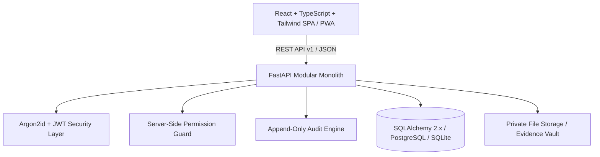

# CivicProof Platform Architecture

## Executive Overview
**CivicProof** is a field-verified infrastructure readiness and asset accountability platform engineered for high-consequence public-sector events (initial reference deployment: **Godavari Pushkaralu 2027**, Rajamahendravaram, Andhra Pradesh).

## Core Paradigm: The Verified Readiness Chain
Traditional municipal tracking tools equate a contractor declaring work complete with actual physical completion. CivicProof strictly enforces a four-state operational barrier:
1. **Reported Progress:** Submitted by vendors or contractors with timestamped evidence.
2. **Inspection-Verified Progress:** Independently verified on-site by certified field engineers executing standardized digital checklists.
3. **Authorized Acceptance:** Formally certified by jurisdiction administrators once all mandatory criteria, evidence, and defect resolutions are satisfied.
4. **Operational Readiness:** System-validated readiness state verifying that linked assets and facilities are physically fit for public use.

---

## High-Level Architecture Diagram

---

## Role-Based Access Control (RBAC) & Separation of Duties
CivicProof enforces distinct roles with strict server-side authorization:
- **Super Administrator:** System settings, role/permission configuration, user lifecycle, and unrestricted audit review.
- **Municipal Administrator:** Jurisdiction oversight, project assignment, review, and final acceptance approval.
- **Project Manager:** Milestone definition, vendor progress tracking, inspection requests, and deadline monitoring.
- **Field Inspector:** Mobile checklist execution, defect creation, evidence attachment, and re-inspection verdicts. (Separation of duty: Inspectors cannot approve their own inspection decisions).
- **Vendor / Contractor:** Work package progress reporting, correction submissions. (Separation of duty: Vendors cannot approve own work or close defects).
- **Asset Manager:** Municipal asset registry, QR code label tracking, and maintenance records.
- **Read-Only Reviewer:** Independent vigilance and audit oversight with view and export capabilities.

---

## Security Architecture
- **Cryptographic Hashing:** Argon2id with 64MB memory cost, 2 iterations, 2 parallelism lanes.
- **Tokens:** Short-lived signed JWTs delivered via HttpOnly cookies and Bearer headers.
- **Audit Logging:** Every security-sensitive transaction (logins, failed attempts, user creations, status changes) is appended to the immutable database audit ledger (`EVT-...`).
