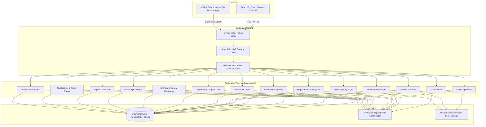

# CivicProof Platform Architecture

## Executive Overview
**CivicProof** is an enterprise-grade, field-verified infrastructure readiness and asset accountability platform engineered for high-consequence public-sector events (reference target: **Godavari Pushkaralu 2027**, Rajamahendravaram, Andhra Pradesh, India).

The platform guarantees transparency, anti-corruption safeguards, and verifiable public readiness across multiple municipal departments, engineering contractors, field inspectors, and administrative jurisdictions.

---

## Core Paradigm: The Verified Readiness Chain

Traditional municipal tracking software relies on contractor claims: when a vendor enters "100% complete", the system reflects completion. CivicProof dismantles this failure mode by enforcing the **Verified Readiness Chain**: a strict four-state operational barrier:

1. **Reported Progress:** Submitted by vendors/contractors with timestamped photographic and documentary evidence. (Contractor claim only; awards 0% authoritative progress).
2. **Inspection-Verified Progress:** Independently verified on-site by certified engineering inspectors executing structured digital checklists with GPS geofencing. Only passed inspections award authoritative progress.
3. **Authorized Acceptance:** Formally certified by jurisdiction administrators once all mandatory criteria, evidence, and defect resolutions are satisfied.
4. **Operational Readiness:** System-validated readiness state verifying that linked assets and facilities are physically fit for public use.

### Traceable 12-Stage Lifecycle Chain
Every work package is traceable across exactly 12 audited stages:
```
[1. Project] 
    └── [2. Work Package] 
            └── [3. Milestones] 
                    └── [4. Vendor Submission] 
                            └── [5. Evidence Vault] 
                                    └── [6. Field Inspection] 
                                            └── [7. Inspection Decision] 
                                                    └── [8. Defects & Rework] 
                                                            └── [9. Re-inspection] 
                                                                    └── [10. Acceptance Gate] 
                                                                            └── [11. Linked Asset] 
                                                                                    └── [12. Operational Readiness]
```

---

## Explainable Risk Engine (Section 14 — Rules A through G)

CivicProof computes a deterministic, explainable readiness risk score (0–100 scale, categorized as Low, Moderate, High, or Severe) for every work package:

| Rule ID | Risk Trigger Description | Default Weight | Formula / Condition |
| :--- | :--- | :--- | :--- |
| **RULE_A** | Overdue Milestone | 25.0 | Target milestone due date passed and milestone is unverified |
| **RULE_B** | Unreported Progress Lag | 20.0 | Milestone due within 14 days and vendor reported progress < 50% |
| **RULE_C** | Failed Inspection Verification | 30.0 | Most recent on-site inspection outcome is `Failed` |
| **RULE_D** | Active Blocking Defect | 30.0 | Unresolved non-conformance with `Critical` or `Major` severity |
| **RULE_E** | Compliance Documentation Lapse | 15.0 | Assigned vendor contract expired or compliance document lapsed |
| **RULE_F** | Critical Path Predecessor Delay | 25.0 | Upstream milestone dependency delayed or blocked |
| **RULE_G** | Spatial / Geofence Non-Compliance | 20.0 | Inspection evidence captured > 500m outside registered ghat geofence |

---

## System Architecture Diagram



---

## 14 Standard Modules Overview

1. **Module 1 — Authentication, Users, Roles, & Permissions:** Argon2id password hashing, signed JWT tokens, 7 government personas, dynamic permission overrides.
2. **Module 2 — Executive Overview Dashboard:** High-level executive command metrics, GIS zone breakdown, and prioritized action queues.
3. **Module 3 — Project and Work Register:** DPR budgets, civil work packages, cycle-protected milestone dependencies, and 9-tab inspection detail.
4. **Module 4 — Vendor and Service-Provider Management:** Contractor performance registry, delayed milestone accountability, and verified progress audits.
5. **Module 5 — Field Verification and Mobile Inspections:** GPS geofencing, checklist execution, evidence vault, and anti-corruption progress accreditation.
6. **Module 6 — Defects, Corrective Action, & Rework:** Quality & safety non-conformance tracking, contractor rework submissions, and independent re-inspection.
7. **Module 7 — Municipal Asset Registry & QR Traceability:** Capital asset register, high-contrast thermal printable QR matrix, and Section 12 readiness gating.
8. **Module 8 — Verified Readiness Chain & Risk Engine:** 12-stage audited lifecycle traceability, explainable 0–100 risk scoring (Rules A through G), and controlled administrative acceptance gates.
9. **Module 9 — Readiness Dependency Graph & Risk Engine:** Visual SVG DAG network, topological sorting, cycle detection, critical path calculation, and Monte Carlo delay simulation.
10. **Module 10 — Geographic Map & Zone Monitoring:** Interactive Leaflet GIS map with ghat boundary polygon overlays, risk-coded marker clusters, and GPS coordinate lookups.
11. **Module 11 — Offline-First Field Workflows:** IndexedDB local storage, background sync queue, idempotent submission deduplication, and clock-drift conflict resolution.
12. **Module 12 — Reports, Exports, & Audit History:** Real-time CSV exports, statutory PDF generation, multi-criteria report filters, and immutable audit logs.
13. **Module 13 — Notifications & Task Management / Action Queue:** In-app notification center, unread counters, role-personalized Action Queues with deep-link resolution.
14. **Module 14 — Administration & System Configuration:** RBAC matrix editor, department directories, ghat location registers, checklist templates, defect SLA rules, and sandbox demo-data reset.

---

## Immutability & Statutory Audit Ledger

Section 19 Invariant: **Tamper-Evident Statutory Audit Immutability**.
- All critical state transitions (logins, status changes, inspection verdicts, defect creations, progress awards, and acceptance decisions) write an append-only event into `audit_events`.
- Each event contains actor ID, timestamp, before/after JSON state snapshots, and cryptographic SHA-256 state hashes.
- Deletion or truncation of audit entries is architecturally rejected by the backend (`DELETE /api/v1/admin/audit-history` returns `403 Forbidden`).
