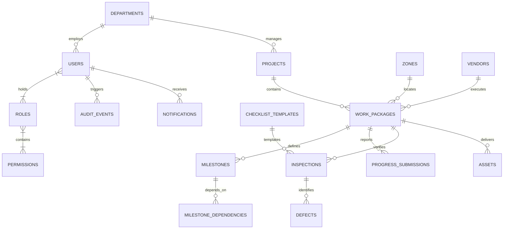

# CivicProof Database Schema Specification

## Database Engine
- **Local / Prototype Deployment:** SQLite 3 (WAL mode enabled, foreign keys enforced).
- **Production Event Deployment:** PostgreSQL 15+ via `psycopg` driver with JSONB and PostGIS capabilities.

---

## Entity Relationship Overview

---

## Detailed Table Schemas

### 1. `departments`
- `id` (VARCHAR(36), PK): UUID
- `code` (VARCHAR(30), UNIQUE, INDEX): e.g., `PWD-R&B`, `RMC-ENG`
- `name` (VARCHAR(150)): Full title of statutory body or municipal department
- `description` (TEXT): Agency responsibilities and Pushkaralu mandate
- `created_at` (TIMESTAMP): Record creation timestamp

### 2. `users`
- `id` (VARCHAR(36), PK): UUID
- `email` (VARCHAR(255), UNIQUE, INDEX): Official government email
- `username` (VARCHAR(100), UNIQUE, INDEX): Unique login identifier
- `full_name` (VARCHAR(150)): Officer name and designation
- `phone` (VARCHAR(20)): Contact mobile number for statutory OTPs
- `password_hash` (VARCHAR(255)): Argon2id cryptographically hashed password
- `department_id` (VARCHAR(36), FK -> `departments.id`): Linked department
- `is_active` (BOOLEAN): Account operational status
- `created_at` (TIMESTAMP): Creation date

### 3. `roles` & `permissions`
- `roles`: `id`, `name` (e.g. `super_admin`, `field_inspector`), `description`, `is_system_role`
- `permissions`: `id` (e.g. `inspections:execute`), `name`, `category`, `description`
- `user_roles`: `user_id` (FK), `role_id` (FK)
- `role_permissions`: `role_id` (FK), `permission_id` (FK)

### 4. `projects`
- `id` (VARCHAR(36), PK): UUID
- `project_code` (VARCHAR(50), UNIQUE, INDEX): Official scheme identifier (e.g., `PRJ-GOD-2027-01`)
- `name` (VARCHAR(200)): Project title
- `category` (VARCHAR(100)): Ghat Development, Drinking Water, Sanitation, Illumination, Crowd Safety
- `department_id` (VARCHAR(36), FK -> `departments.id`)
- `zone_id` (VARCHAR(36), FK -> `zones.id`): Primary deployment sector
- `budget_sanctioned` (FLOAT): Approved DPR capital expenditure in INR
- `budget_spent` (FLOAT): Audited disbursed capital
- `status` (VARCHAR(50)): `Planning`, `In Progress`, `Under Inspection`, `Completed`, `Accepted`
- `start_date` / `target_completion_date` (DATE)

### 5. `work_packages`
- `id` (VARCHAR(36), PK): UUID
- `work_id` (VARCHAR(50), UNIQUE, INDEX): Formal contract package code (e.g., `WP-DW-KOTI-01`)
- `project_id` (VARCHAR(36), FK -> `projects.id`)
- `title` (VARCHAR(200)): Scope description
- `contractor_id` (VARCHAR(36), FK -> `vendors.id`)
- `workflow_state` (VARCHAR(50)): `Not Started`, `In Progress`, `Under Verification`, `Rework Required`, `Accepted`
- `reported_progress_percentage` (FLOAT): Vendor claim (0.0 to 100.0)
- `verified_progress_percentage` (FLOAT): Authoritative engineer verification (0.0 to 100.0)
- `risk_score` (FLOAT): Computed 0–100 explainable risk score
- `risk_level` (VARCHAR(20)): `Low`, `Moderate`, `High`, `Severe`

### 6. `milestones` & `milestone_dependencies`
- `milestones`: `id`, `work_package_id`, `milestone_code`, `title`, `due_date`, `verification_status` (`Pending`, `Submitted`, `Verified`)
- `milestone_dependencies`: `milestone_id` (FK), `depends_on_id` (FK)

### 7. `vendors`
- `id` (VARCHAR(36), PK): UUID
- `vendor_code` (VARCHAR(50), UNIQUE)
- `company_name` (VARCHAR(200))
- `category` (VARCHAR(100))
- `contract_reference` (VARCHAR(100))
- `status` (VARCHAR(50)): `Active`, `Suspended`, `Debarred`
- `compliance_status` (VARCHAR(50)): `Compliant`, `Renewal Due`, `Non-Compliant`
- `compliance_document_expiry` (DATE)

### 8. `inspections`
- `id` (VARCHAR(36), PK): UUID
- `inspection_id` (VARCHAR(50), UNIQUE, INDEX): e.g., `INSP-2026-DW01-01`
- `work_package_id` (VARCHAR(36), FK -> `work_packages.id`)
- `inspector_id` (VARCHAR(36), FK -> `users.id`)
- `scheduled_date` (DATE)
- `actual_inspection_date` (TIMESTAMP)
- `inspection_type` (VARCHAR(100))
- `outcome` (VARCHAR(50)): `Scheduled`, `Passed`, `Failed`, `Requires Re-inspection`
- `checklist_results` (JSON): Itemized verification verdicts, measurements, and criteria notes
- `evidence_photos` (JSON): Timestamped photo array with GPS coordinates
- `latitude` / `longitude` / `gps_accuracy_meters` (FLOAT)
- `is_geofence_verified` (BOOLEAN)
- `verified_percentage_awarded` (FLOAT)
- `reviewer_decision` (VARCHAR(50)): `Approved`, `Rejected`

### 9. `defects`
- `id` (VARCHAR(36), PK): UUID
- `defect_code` (VARCHAR(50), UNIQUE, INDEX): e.g., `DEF-2026-001`
- `inspection_id` (VARCHAR(36), FK -> `inspections.id`)
- `work_package_id` (VARCHAR(36), FK -> `work_packages.id`)
- `severity` (VARCHAR(50)): `Critical`, `Major`, `Minor`, `Cosmetic`
- `status` (VARCHAR(50)): `Open`, `In Rework`, `Ready for Re-inspection`, `Closed`
- `sla_deadline` (TIMESTAMP)
- `rework_notes` / `rework_evidence` (JSON)
- `is_blocking` (BOOLEAN)

### 10. `assets`
- `id` (VARCHAR(36), PK): UUID
- `asset_code` (VARCHAR(50), UNIQUE, INDEX): e.g., `AST-DW-KOTI-001`
- `qr_code_hash` (VARCHAR(64), UNIQUE, INDEX): Cryptographic identifier
- `name` (VARCHAR(200))
- `category` (VARCHAR(100))
- `work_package_id` (VARCHAR(36), FK -> `work_packages.id`)
- `zone_id` (VARCHAR(36), FK -> `zones.id`)
- `lifecycle_status` (VARCHAR(50)): `Procured`, `Installed`, `Under Inspection`, `Verified`, `Accepted`, `Operational`
- `latitude` / `longitude` (FLOAT)

### 11. `system_settings` & `checklist_templates`
- `system_settings`: `key` (PK), `value_json` (JSON), `category`, `description`, `last_updated_at`, `last_updated_by`
- `checklist_templates`: `id`, `template_code` (UNIQUE), `name`, `category`, `version`, `is_active`, `items` (JSON)

### 12. `audit_events` (Append-Only Statutory Ledger)
- `id` (VARCHAR(36), PK): UUID
- `event_id` (VARCHAR(50), UNIQUE, INDEX): e.g., `EVT-20261101-9872`
- `actor_id` (VARCHAR(36), FK -> `users.id`)
- `action` (VARCHAR(100)): e.g., `INSPECTION_SUBMITTED`, `DEFECT_LOGGED`, `ACCEPTANCE_GRANTED`
- `entity_type` (VARCHAR(50)): `work_package`, `inspection`, `defect`, `asset`, `role`, `config`
- `entity_id` (VARCHAR(50))
- `before_state` (JSON)
- `after_state` (JSON)
- `client_ip` / `user_agent` (VARCHAR)
- `timestamp` (TIMESTAMP, INDEX)
- `state_hash` (VARCHAR(64)): SHA-256 state seal
