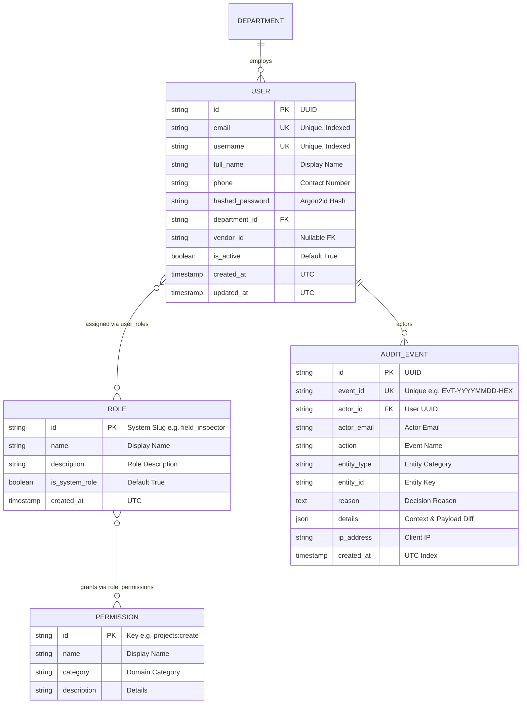

# CivicProof Database Schema Documentation

## Entity Relationship Overview
The database uses normalized relational structures with foreign-key constraints, indexes on lookup fields, timezone-aware UTC timestamps, and UUID primary keys.

## Security & Immutability Rules
1. `audit_events` is strictly append-only. No application API or UI route exposes `UPDATE` or `DELETE` capabilities.
2. User deactivation updates `is_active = False` rather than hard deletion to preserve historical foreign-key integrity in inspections and approvals.
